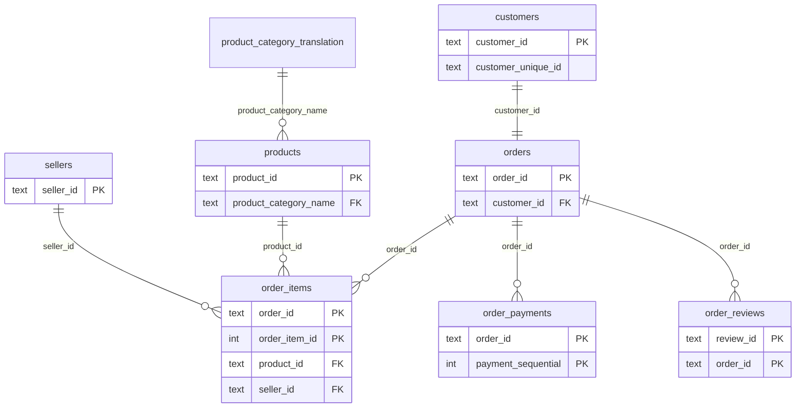

# Entity Relationship Diagram

Olist dataset — 8 tables (geolocation excluded). Only key columns shown.

## Grain notes
- `customer_id` is generated per order → real customers are counted with `customer_unique_id`.
- `order_reviews` grain is `(review_id, order_id)`; some orders have multiple reviews, some have none.
- An order can contain items from multiple sellers (`seller_id` is at item level).
- Never join two N-side tables (e.g. `order_items` and `order_payments`) directly → fan-out.